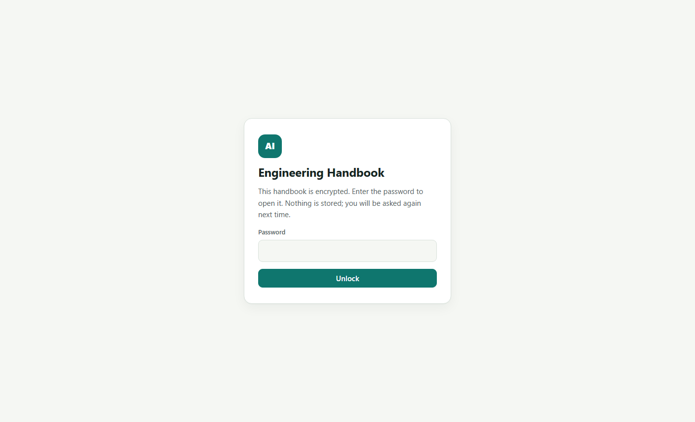

# AI Engineering Handbook

A password-protected web app: cheatsheet, interview flashcards, 25 one-hour projects with starter code, and daily-life ideas for TypeScript, the AI SDK, and context engineering. Progress is saved in your browser.

The content is **encrypted** (AES-256-GCM, key derived with PBKDF2) before it is committed or deployed. The site asks for the password on every visit, decrypts in the browser, and never stores the password. Without the password the deployed files contain only ciphertext. The readable source content lives only on the author's machine and is not in this repository.

## Screenshots

The lock screen. The site uses a single light theme: a red accent on warm neutrals with glass panels (translucent, blurred surfaces) floating over a soft layered background. Screenshots of the pages behind the password are intentionally not published.



Behind the lock: a home page with progress and a learning path, seven cheatsheet tabs (each with a 3-minute summary, an in-depth section that explains every core idea in plain words with analogies and several examples, and technique sections with code and sample runs) (TypeScript, AI SDK, Context Engineering, Production, Required Tools, Platforms & Resources covering OpenAI, Google, Mistral, open-weight and local models, gateways, vector stores, frameworks and learning resources, and a Remember It tab with a daily loop, mnemonics, and a never-forget list), 98 interview flashcards including 24 fundamentals, each with an "Example to explain" (a short code snippet or a spoken scenario) under the answer, 28 project cards with starter code, 16 daily-life ideas, and search across everything. The sidebar collapses to an icon rail with the chevron or the `[` key, and the cheatsheet outline can be hidden.

## Run it locally

```bash
pnpm install
pnpm encrypt      # reads HANDBOOK_PASSWORD from .env, writes public/content.enc
pnpm dev          # opens http://localhost:5173 and asks for the password
```

`pnpm encrypt` needs the readable content under `src/content/` (gitignored) and a `.env` file:

```
HANDBOOK_PASSWORD=your-password-here
```

## Change the password

1. Put the new password in `.env`.
2. `pnpm encrypt`
3. Commit `public/content.enc` and push. The next deploy uses the new password; the old one stops working.

## Deploy

Pushing to `main` runs `.github/workflows/deploy.yml`, which builds the site and publishes `dist/` to GitHub Pages. The workflow fails on purpose if `public/content.enc` is missing, so a deploy can never ship without encrypted content.

## Build a static copy

```bash
pnpm build        # type-checks, then writes dist/
pnpm preview      # serves dist/ at http://localhost:4173
```

`dist/` is plain HTML, CSS, JS, and `content.enc`. Serve it from any static host over HTTPS (the browser's WebCrypto API requires a secure context; `localhost` also counts).

## Edit the content

| What | Where (local only, gitignored) |
|---|---|
| Cheatsheet topics | `src/content/cheatsheet/*.md` (one Markdown file per tab) |
| Interview questions | `src/content/questions.ts` |
| Projects and starter code | `src/content/projects.ts` |
| Daily-life ideas | `src/content/ideas.ts` |

After editing, run `pnpm encrypt` and commit the new `public/content.enc`.

Keyboard: `/` focuses search, `Esc` clears it. The sidebar has a Lock button that drops the decrypted content from memory.

## Verified behaviour

Checked in headless Chrome against the production build, with no console errors or exceptions:

- Wrong password shows an error; the right one decrypts and renders.
- All six cheatsheet tabs render their sections as collapsible concept cards, with expand-all and collapse-all working on cheatsheet, project, and idea pages (starter-code blocks stay closed).
- "Show all answers" and "Hide all answers" on the interview page, and the result-type filters on the search page, work.
- Flashcards reveal answers, mark known or review, and the "Hide mastered" filter works.
- Project checkboxes tick, starter code expands, and progress survives a reload (the password does not).
- Search updates live from the sidebar and links jump to the matching section with a highlight.
- Two-click reset, Lock, sidebar collapse, and the responsive layout at narrow widths all behave.

## Stack

Vite, TypeScript, `marked` for Markdown, `highlight.js` for code, WebCrypto for decryption. No framework, no server.
